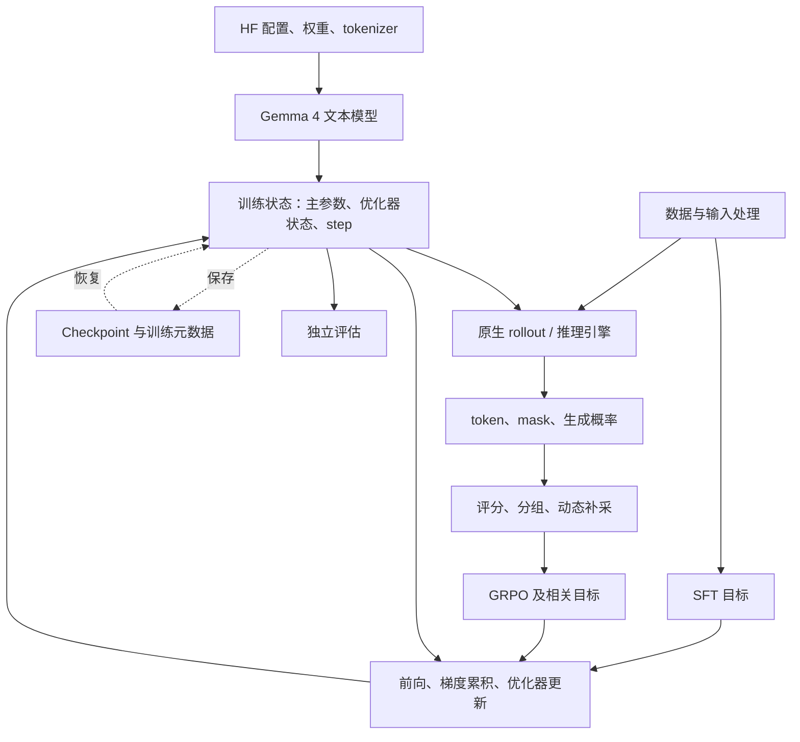

# 整体设计

本项目基于Gemma 4 E2B 文本模型，在 JAX/TPU 上实现监督微调（Supervised Fine-Tuning，SFT）和基于组相对策略优化（Group Relative Policy Optimization，GRPO）的强化学习训练。本文介绍项目的整体设计，包括模型与训练状态、GRPO 训练流程、TPU 上的计算与分片、保存与恢复，以及可选的推理后端 tpu-inference。

核心计算采用显式参数输入和状态返回。Python 主机循环负责数据、评分、流程调度和文件操作；JAX 编译函数负责模型前向、反向传播、优化器更新与原生生成。原生 JAX rollout 是默认路径，tpu-inference 通过适配层作为可选实验后端接入。

## 1. 总体结构

SFT 和 GRPO 最主要的区别在于训练回答的来源。SFT 直接使用数据集提供的目标回答；GRPO 则先让模型生成回答，再由评分器打分，根据评分结果计算训练目标。回答和训练目标确定后，两条路径使用同一套模型前向、目标 token logprob 计算、优化器、参数分片和 checkpoint 机制，不需要分别维护一套训练系统，主要区别集中在数据组织方式和损失函数上。

各部分的代码位置如下：

| 部分 | 主要职责 | 实现 |
|---|---|---|
| 模型与权重 | 加载 HF 配置、转换预训练权重、实现文本模型前向 | [weights.py](../gemma4_posttrain_jax/weights.py)、[model.py](../gemma4_posttrain_jax/model.py) |
| 训练计算 | 构造算法目标、计算梯度、累积 microbatch、更新参数 | [algorithms.py](../gemma4_posttrain_jax/algorithms.py)、[losses.py](../gemma4_posttrain_jax/losses.py) |
| 原生生成 | prefill、带缓存的逐 token 解码、采样，并记录生成结果 | [sampler.py](../gemma4_posttrain_jax/sampler.py) |
| 数据与评估 | 数据顺序、题目编号、输入处理、评分和评估记录 | [data.py](../gemma4_posttrain_jax/data.py)、[evaluation.py](../gemma4_posttrain_jax/evaluation.py) |
| 设备布局 | 定义参数、训练状态和输入 batch 在 TPU 设备间的分片方式 | [sharding.py](../gemma4_posttrain_jax/sharding.py) |
| 保存与恢复 | 保存训练数组、校验 checkpoint、按目标分片加载状态 | [checkpoint.py](../gemma4_posttrain_jax/checkpoint.py) |
| 训练入口 | 生成、更新、评估、保存和续训的完整流程 | [train_sft.py](../scripts/train_sft.py)、[train_grpo.py](../scripts/train_grpo.py) |

## 2. 模型与训练状态

模型实现保留 Gemma 4 的逐层注意力类型、共享键值、滑动窗口、逐层输入嵌入（Per-Layer Embeddings，PLE）、旋转位置编码（Rotary Position Embedding，RoPE）及逐层缩放。输入 embedding 与输出头共享权重。HF 映射同时处理参数名称、维度布局和计算语义，[前向测试](../tests/test_model_ops.py)和[梯度对照](../tests/test_grad_parity.py)检查它与 Transformers 的对应计算。

训练过程由 TrainState 管理，包含三个字段：
- `params_f32`：FP32 主参数
- `opt_state`：优化器状态
- `step`：已经执行的参数更新次数

模型参数和 Adam 状态默认以 FP32 保存，前向和反向计算则可以使用 BF16。保留 FP32 主参数主要是为了避免小幅更新在 BF16 舍入时丢失。训练中的单步参数变化可能很小，如果每次都直接更新 BF16 权重，一部分变化就无法保留下来。使用 FP32 主参数可以逐步累积这些更新，同时在计算时利用 BF16 降低内存和计算开销。

如果冻结 embedding，它仍然参与模型前向，但不需要为它维护 Adam 的一阶矩和二阶矩。

TrainState 不负责保存所有训练信息。模型配置、tokenizer、数据读取进度和日志由训练入口管理；其中恢复训练所必需的信息，例如数据处理到的位置，会写入 checkpoint 元数据。

基础模型文件和数据文件仍需要由使用者提供。

## 3. GRPO 训练流程

GRPO 训练以 iteration（迭代）为单位进行。一次 iteration 从读取一个 prompt batch 开始，经过回答生成、奖励计算和 advantage 计算，最后使用这些回答更新模型参数。每个 iteration 可以包含多次参数更新，因此 iteration 和 optimizer step 并不一定相同。下面按照实际执行顺序介绍整个过程。

### 3.1 回答生成与评分

每次 iteration 首先读取一个 prompt batch，模型为每个 prompt 生成多条回答，组成一个 rollout batch。生成结果保存在 `RolloutBatch` 中：

| 字段 | 内容 |
|---|---|
| `prompt_ids` | 生成时使用的 prompt token |
| `completion_ids` | 实际生成的回答 token |
| `completion_mask` | 有效回答位置，包括第一个 EOS，不包括之后的 padding |
| `rollout_logps` | 生成时记录的原始策略 logprob，无效位置为零 |
| `lengths` | 每条回答的有效长度 |

生成结束后，程序将回答解码成文本，由评分器计算奖励，再根据同一个 prompt 下各条回答的奖励计算 advantage。启用动态补采时，程序还可以继续生成候选 batch，直到满足训练所需的条件。这里需要注意，文本只用于评分和展示。后续训练直接使用 `completion_ids`，不会将回答文本重新分词，因为重新编码得到的 token 序列不一定与实际生成的序列相同。

### 3.2 策略概率与参数更新

得到 rollout batch 和 advantage 后，程序开始计算训练目标。这里涉及四种策略概率：

- Behavior：实际生成回答时的策略概率，保存在 `rollout_logps` 中
- Old：使用 rollout batch 第一次进行训练前向计算时得到的概率，在后续更新中保持固定
- Current：每次更新时使用当前模型参数重新计算的概率，是梯度计算的对象
- Reference：固定参考模型的概率，仅在启用 KL 正则时计算

Behavior 和 Old 即使使用相同的模型参数，数值也可能略有不同。生成时使用 KV cache 逐 token 解码，训练时则对完整序列计算概率，两种方式的浮点计算顺序不同。因此，Old 由训练前向计算，而不是直接复用生成时记录的 Behavior。

`rollout_logps` 记录的是完整词表上的原始模型 logprob，没有经过温度缩放或 top-k、top-p 截断。当前 GRPO 入口使用温度 1 和完整词表采样，与这一概率定义一致。如果改变采样分布，就需要相应调整训练计算，不能直接沿用原来的概率处理方式。

同一个 rollout batch 可以用于 μ 次参数更新，每次都使用最新参数重新计算 Current logprob 和梯度。这里还需要区分 microbatch：它只是把一次参数更新所需的 batch 拆成若干部分，分别计算并累积梯度，最后执行一次 Adam 更新。

因此，**一次 iteration 包含一次 rollout 和 μ 次 optimizer step**。增加 microbatch 数量不会改变参数更新次数，而增加 μ 会让同一个 rollout batch 参与更多次更新。

完成这 μ 次更新后，训练函数返回新的状态和指标，主机程序再开始下一个 iteration，或根据配置执行评估和 checkpoint 保存。

不同策略概率如何参与目标函数，以及 GRPO 与其他算法的区别，见 [GRPO 及相关算法](grpo-and-related-algorithms.md)。

## 4. 在 TPU 上执行

### 4.1 主机和设备的分工

训练过程由 Python 主机程序组织，但主要的数值计算都交给 TPU。

主机负责读取数据、tokenizer、奖励计算、动态补采、日志和 checkpoint 文件操作。模型前向、反向传播、优化器更新以及原生生成则使用 `jax.jit` 编译后在 TPU 上执行。

原生 rollout 分成两个阶段。首先通过 prefill 处理完整 prompt，建立初始 KV cache；随后使用 lax.while_loop 逐 token 解码，并持续更新缓存。不同注意力层使用不同的缓存方式。全局注意力层需要保留完整历史 KV，滑动窗口注意力层只保留窗口范围内的数据，通过环形缓存循环覆盖旧位置。当前原生生成按固定 batch 执行，不包含通用推理 serving 中面向动态请求的调度和连续批处理机制。

### 4.2 数据和参数在TPU上的分布

项目使用一维设备 mesh，轴名为 d。主要实验环境是 TPU v4-8，对应 4 个 JAX 设备。

训练参数采用全分片数据并行（Fully Sharded Data Parallel，FSDP）的布局。较大的参数张量分布在多个设备上，每个设备只保存其中一部分。对应的梯度和 Adam 状态也按照相同规则分片；较小的向量和标量通常会复制到各个设备。计算过程中需要哪些跨设备通信，由 JAX/XLA 根据计算和分片布局安排。

训练和生成不一定使用相同的参数布局。进入 rollout 阶段时，程序可以按生成需要的布局准备一份权重副本；生成结束后释放这份副本，训练参数始终保持原来的分片布局。这些布局转换产生的开销也计入训练迭代耗时。

为了检查运行时真正使用了什么布局，GRPO 入口提供 `--audit-execution-layout`，启用后，程序会在第一批生成前写出 `execution_layout.json`，记录实际参与运行的进程和设备，以及各个训练状态数组、生成权重的分片形状和设备位置。这项检查读取的是 JAX 数组已有的分片信息，不需要把完整权重复制回主机，可以用来确认实际执行布局是否符合预期，而不只是检查命令行中指定了什么参数。

### 4.3 大词表 logprob 计算

Gemma 4 词表较大，训练时如果先算出完整的 `[batch, sequence, vocabulary]` logits，再取目标 token 的概率，就需要构造一个很大的中间张量，显著增加内存开销。

项目没有直接保留完整 logits，而是沿 token 和词表维度分块，通过 log-sum-exp 计算归一化项，同时只提取训练目标 token 对应的分数。在此基础上，还实现了显式词表并行。每个设备只负责一部分词表，分别计算本地归一化统计量，再通过跨设备通信合并。这样可以减少大型输出头权重在设备间的通信需求。相关实现位于 [losses.py](../gemma4_posttrain_jax/losses.py)。

项目还提供 `--logprob-backend pallas` 作为实验选项，在词表并行的前提下，保留了原生模型前向、对 hidden 的梯度计算，以及目标 token 对应的权重梯度，只使用 Pallas 计算归一化项对输出权重的梯度。

目前该实现仅支持已经适配的四设备 TPU v4、BF16 配置。默认后端仍然是 jax，Pallas logprob 也不会替换生成阶段的输出头计算，后续会继续开发，支持更多 Pallas 后端的加速计算。

### 4.4 内存管理

训练时使用了几种不同的内存优化方法，解决不同的问题：

- Microbatch：减少一次计算中同时处理的样本数量，降低激活等中间数据的内存需求。

- Rematerialization（remat）：在反向传播时重新计算部分前向结果，避免长时间保存全部激活。

- Buffer donation：允许编译器复用调用后不再需要的输入缓冲区，减少额外的内存分配。

项目在实际执行 Adam 更新的训练函数上测内存和耗时，为了调试而返回完整梯度的诊断函数会单独测量，避免把诊断开销误认为正常训练成本。

还需要注意，Behavior、Old、Current、Reference 虽然都称为策略，但不代表设备上同时保存了四套完整模型，实际的权重和训练状态按以下方式存储：

| 对象 | 放在哪里、什么精度、存在多久 |
|---|---|
| 当前训练参数 | 训练 TPU 上的一套 FP32 主参数，按训练 mesh 分片；计算图按需要产生 BF16 计算值 |
| Adam 状态 | 训练 TPU 上可训练参数的一阶矩和二阶矩，均为 FP32；冻结参数不保存对应的 Adam 矩 |
| 原生生成参数 | 生成阶段由主参数转换为 BF16，可复制或分片；生成结束后释放这份工作副本 |
| 引擎生成参数 | 推理 TPU 上的 BF16 权重；当前 DP2/TP1 配置在两颗推理芯片上各有完整副本 |
| Old 与 Behavior 概率 | 固定回答的 FP32 logprob 数组，不各自保存一整份模型；Old 按需要捕获，Behavior 来自生成结果 |
| Reference 参数 | 仅启用 KL 时建立；固定 BF16 副本放在 CPU，计算参考概率时临时放入训练 TPU，计算后释放 |

因此，在同步的 2+2 推理引擎配置中，主要长期保留的是训练侧一套分片 FP32 主参数、Adam 状态，以及推理侧两份 BF16 权重副本。原生 JAX 路径则让同一组 TPU 轮流执行生成和训练。在默认 replicated 布局下，每个设备会获得一份完整的 BF16 生成权重，但这份工作副本不会与 Reference 权重同时常驻设备。如果启用顺序滞后生成，还需要在 CPU 上保存一份较旧的 BF16 行为策略快照。

不过，实际峰值 HBM 占用不能只根据模型副本数量估算，生成时还需要 KV cache，训练时需要激活和梯度，而权重同步和布局转换期间也可能短暂保留新旧两份权重，这些临时数据都可能影响峰值内存。

## 5. 保存与恢复

项目的 checkpoint 包含两个主要文件：

* `state.safetensors` 保存模型参数、优化器状态和更新次数
* `meta.json` 保存 checkpoint 格式信息、数组描述，以及训练入口提供的运行配置和数据进度

保存时，程序从当前进程能够访问的设备分片中分块读取数组，每次最多读取 64 MiB，再按照数组的逻辑顺序写入文件。这样不需要先在主机内存中拼接出完整的大型参数张量，也能完成保存。文件会先写入临时目录，全部写完后再重命名，避免把尚未完成的文件当成有效 checkpoint。

加载时，程序先检查数组名称、形状和 dtype，确认与目标训练状态兼容，再按照调用方提供的分片规则把数组放回设备。这种分块读写不会改变 checkpoint 的文件格式，但目前也不等同于支持多个主机联合保存。

### 5.1 恢复训练需要哪些状态

断点续训的准确完成不仅需要模型参数和优化器状态，还需要恢复数据读取位置以及后续随机数的生成方式。

SFT 会保存数据流状态，原生 GRPO 则维护单独的 data_cursor，表示候选批次读取到了哪里，并使用 `fold_in(base_key, data_cursor)` 为每批候选数据生成随机 key。这里不能简单地用 Adam step 代替 data_cursor。因为动态补采可能读取并丢弃某些候选批次，这些批次虽然没有产生参数更新，但仍然消耗了数据位置和随机数。如果启用了顺序滞后生成，还需要额外保存行为策略快照和对应的版本号。

GRPO 只会在一轮的 μ 次更新全部完成后保存 checkpoint。这个时间点没有正在进行的梯度累积，下一轮也会重新生成回答，因此不需要保存解码到一半的 KV cache 或尚未完成的 microbatch 状态。

重新启动训练时，新进程会重新建立设备 mesh、目标分片和编译函数，再从 checkpoint 加载训练状态。checkpoint 不保存旧进程的设备对象或编译后的可执行程序。

### 5.2 数值后端与兼容性

使用 Pallas logprob 时，checkpoint 元数据还会记录所使用的后端和数值实现版本。SFT 和 GRPO 在续训时都会检查这些信息，避免在没有明确处理数值差异的情况下切换实现。旧版本没有记录后端信息的 JAX checkpoint 仍可以恢复，但如果希望切换 logprob 后端，需要开始一次新的训练。

当前恢复机制主要面向单主机和已经验证的设备配置。

跨主机 checkpoint、改变设备布局后保持完全一致的训练轨迹、从解码中途继续，以及恢复异步生成队列等能力，都需要进一步实现和验证。

### 5.3 检查断点续训的恢复

训练能够从 checkpoint 继续运行，并不代表恢复后的状态与连续训练一致。

项目采用两种方式进行验证：

- 对于短实验，[四步恢复示例](../examples/e2b_grpo_recovery.sh)分别执行连续训练和中途恢复训练，保留两条路径的最终 checkpoint，对比训练结果，并分别加载末态进行独立评估

- 对于较长的实验，同时保留两条路径的最终 checkpoint 存储成本较高，因此使用逐数组校验值进行比较
    - [GSM8K 完整实验](../examples/e2b_grpo_gsm8k.sh)采用的是第二种方式
    - `--audit-final-state` 在训练结束时计算每个参数和 Adam 状态数组的校验值
    - `--audit-loaded-state` 在独立评估时检查加载后的状态
    - 通过比较连续训练、恢复训练和重新加载后的校验记录，可以检查它们的最终状态是否一致，而不必同时保留两条路径的最终 checkpoint

## 6. 原生 rollout 与 tpu-inference

项目默认使用原生 JAX 生成，通过 `--rollout-backend jax` 选择。

此外，还可以使用 `--rollout-backend inference` 来接入 tpu-inference 作为独立的推理后端，推荐在同一个 Python 进程中运行训练计算和推理引擎，并通过 TPU 的 ICI 同步权重，`--inference-weight-transport auto`。

ICI（Inter-Chip Interconnect）是 TPU 芯片间的高速互联。原生生成和 tpu-inference 都可能使用 ICI，但它们使用 TPU 的方式不同：训练和推理分别占用哪些设备、权重如何存放，以及什么时候发生跨设备通信，都取决于具体布局。

### 6.1 可选的 rollout 方式

| 生成方式 | 芯片怎样使用 | 通信做什么 |
|---|---|---|
| 原生 rollout，`--rollout-layout replicated` | 训练和生成轮流使用同一组四设备；生成时每个设备保存完整 BF16 权重 | 生成开始前，将训练中分片存储的权重汇集并复制到各设备 |
| 原生 rollout，`--rollout-layout fsdp` | 训练和生成仍使用同一组四设备；生成阶段保留分片权重 | 生成计算过程中，由 JAX/XLA 根据分片安排跨设备通信 |
| tpu-inference，同进程 ICI 配置 | 训练和引擎使用同一个进程与 JAX 运行时；默认两设备训练、两设备推理 | 将训练侧更新后的权重传到推理设备，并转换为引擎需要的 dtype 和布局 |

原生 rollout 的权重转换由 [reshard_for_rollout](../gemma4_posttrain_jax/sharding.py) 完成。

即使训练和生成使用同一组设备，两者仍然可能采用不同的权重布局。默认 replicated 方式会在生成前一次性准备完整的 BF16 权重副本，因此后续逐 token 解码不需要反复跨设备同步整套模型参数。相比之下，FSDP 生成布局会继续使用分片权重，跨设备通信可能发生在生成计算内部。

### 6.2 tpu-inference 适配层

[InferenceRollout](../gemma4_posttrain_jax/inference_rollout.py) 把 tpu-inference 接到与原生 rollout 相同的接口上。

训练器仍然负责管理 FP32 主参数和优化器状态；推理适配层负责将更新后的权重同步给引擎、检查权重版本，并把引擎返回的生成结果转换为训练所需的格式。

其中，[权重映射与检查](../gemma4_posttrain_jax/inference_weights.py)负责把权重转换成引擎需要的类型和布局，并核对内容。

每次权重同步都会分配递增的版本号。生成请求和返回结果都需要通过版本检查，避免训练器在不知情的情况下使用错误版本的策略结果。

权重切换后的缓存失效、引擎内部随机状态以及相关进程的生命周期，则由推理后端管理。

### 6.3 同进程运行方式

这里所说的“同进程”，是指训练模型计算和推理引擎模型计算位于同一个 Python 进程，共用 JAX 运行时，并不意味着引擎完全不会创建辅助进程。

启动时，程序会在导入引擎之前设置 `VLLM_ENABLE_V1_MULTIPROCESSING=0` 和 `TPU_MULTIPROCESS_DP=0`，并确认实际使用的是 `InprocClient` 和 `UniProcExecutor`。在这一配置下，推理计算在同一进程中执行，但 DP 调度器仍会启动一个 CPU 上的调度子进程。

推理引擎通过 Python 接口调用，不需要另起 HTTP 服务。

### 6.4 其它进程和权重传输方式

除了推荐的同进程方式，项目还保留了两种双进程实现，主要用于开发、复现和对照不同的运行时及传输行为，目前不推荐使用：

| 对照配置 | 实现方式 |
|---|---|
| `--rollout-backend inference-process` | 训练和推理运行在独立的 Python 进程中，分别使用自己的 JAX 运行时，可以采用不同依赖环境；目前各使用两设备，通过主机中转权重 |
| `--rollout-backend inference-distributed` | 训练和推理使用两个 Python 进程，共享分布式运行时，要求相同的 JAX/libtpu 环境；目前各使用两设备，通过 ICI 同步权重 |

在这两种配置下，`--inference-weight-transport auto` 分别选择主机中转（主机中转会慢很多，所以建议完全不使用）和 ICI传输。

需要注意，分布式运行时不会仅因为切换了传输参数就自动建立。使用 inference-distributed 时，调用方需要先初始化共同的分布式环境，再启动训练端和推理接收端。

双进程实现也不代表训练与生成已经实现异步重叠执行。当前这些配置主要用于比较进程隔离方式、运行时行为和权重传输机制，而不是提供完整的异步训练流水线。

### 6.5 当前限制

tpu-inference 依赖固定版本的推理引擎环境和 libtpu，因此实际使用时需要针对具体配置验证完整流程，包括模型生成、权重同步、参数更新、checkpoint 保存和恢复。

目前已有的同步数组测试只验证权重传输本身，项目也尚未在相同模型、数据和训练配置下，对原生生成、同进程 tpu-inference 和两种双进程方式进行完整的端到端性能对比。因此，当前推荐同进程 ICI 配置，主要是基于其运行时与权重同步设计。
