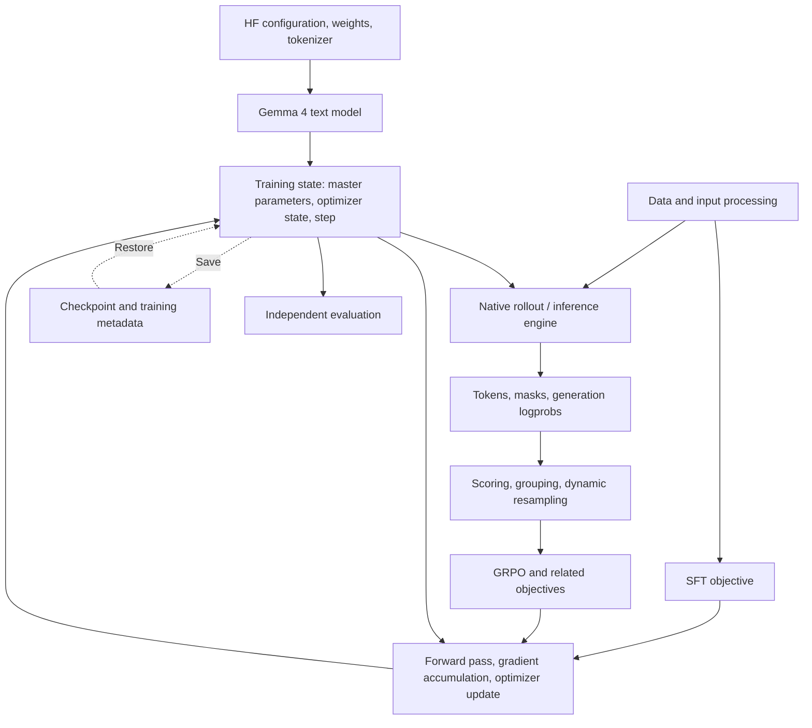

# Design overview

**English** | [简体中文](design-overview.zh-CN.md)

This project implements supervised fine-tuning (SFT) and reinforcement learning with Group Relative Policy Optimization (GRPO) for the Gemma 4 E2B text model on JAX/TPU. This document covers the model and training state, the GRPO training loop, TPU computation and sharding, checkpoint save and restore, and the optional tpu-inference backend.

Core computations take parameters explicitly and return updated state. The Python host loop handles data, rewards, orchestration, and file operations. Compiled JAX functions handle model forward passes, backpropagation, optimizer updates, and native generation. Native JAX rollout is the default; tpu-inference connects through an adapter as an experimental alternative.

## 1. Overall structure

The main difference between SFT and GRPO is where the training responses come from. SFT uses target responses from the dataset. GRPO first generates responses, scores them, and constructs the objective from those scores. Once the responses and objective are defined, both use the same model forward pass, target-token logprob computation, optimizer, parameter sharding, and checkpoint mechanism. The differences are concentrated in data organization and loss functions, so the project does not need two separate training systems.

| Component | Responsibility | Implementation |
|---|---|---|
| Model and weights | Load HF configuration, convert pretrained weights, and implement the text-model forward pass | [weights.py](../gemma4_posttrain_jax/weights.py), [model.py](../gemma4_posttrain_jax/model.py) |
| Training computation | Construct objectives, compute and accumulate microbatch gradients, and update parameters | [algorithms.py](../gemma4_posttrain_jax/algorithms.py), [losses.py](../gemma4_posttrain_jax/losses.py) |
| Native generation | Prefill, cached token-by-token decoding, sampling, and TP generation | [sampler.py](../gemma4_posttrain_jax/sampler.py), [tp_rollout.py](../gemma4_posttrain_jax/tp_rollout.py) |
| Data and evaluation | Data order, question IDs, input processing, scoring, and evaluation records | [data.py](../gemma4_posttrain_jax/data.py), [evaluation.py](../gemma4_posttrain_jax/evaluation.py) |
| Device layout | Shard parameters, training state, and input batches across TPU devices | [sharding.py](../gemma4_posttrain_jax/sharding.py) |
| Checkpoint save and restore | Save training arrays, validate checkpoints, and load state into the target sharding | [checkpoint.py](../gemma4_posttrain_jax/checkpoint.py) |
| Training entry points | Coordinate generation, updates, evaluation, checkpointing, and recovery | [train_sft.py](../scripts/train_sft.py), [train_grpo.py](../scripts/train_grpo.py) |

## 2. Model and training state

The model preserves Gemma 4's attention type for each layer, shared keys and values, sliding windows, Per-Layer Embeddings (PLE), Rotary Position Embeddings (RoPE), and layer scaling. Input embeddings and the output head share weights. HF conversion handles parameter names, dimension layouts, and computation semantics. [Forward tests](../tests/test_model_ops.py) and [gradient comparisons](../tests/test_grad_parity.py) check the corresponding calculations against Transformers.

`TrainState` has three fields:

- `params_f32`: FP32 master parameters.
- `opt_state`: optimizer state.
- `step`: number of parameter updates completed.

Parameters and Adam state are stored in FP32 by default, while forward and backward computation can use BF16. FP32 master parameters preserve small updates that BF16 rounding could otherwise discard. An individual training update can be too small to change a BF16 weight; accumulating updates in FP32 retains these changes while BF16 computation reduces memory and compute costs.

Frozen embeddings still participate in the forward pass, but do not require Adam first- and second-moment arrays.

The training entry point manages model configuration, the tokenizer, data position, and logs. Information required for recovery, such as the position in the dataset, is written to checkpoint metadata. Users still need to supply the base-model files and data files.

## 3. The GRPO training loop

A GRPO iteration starts with a prompt batch, generates and scores responses, computes advantages, and uses those responses to update the parameters. One iteration can contain several parameter updates, so an iteration and an optimizer step are not necessarily the same. The following sections follow execution order.

### 3.1 Generate and score responses

At the start of each iteration, the model generates several responses per prompt, forming a rollout batch. `RolloutBatch` stores:

| Field | Contents |
|---|---|
| `prompt_ids` | Prompt tokens used for generation |
| `completion_ids` | Tokens actually generated for each response |
| `completion_mask` | Valid response positions, including the first EOS and excluding subsequent padding |
| `rollout_logps` | Raw policy logprobs recorded during generation, with zeros at invalid positions |
| `lengths` | Valid length of each response |

After generation, responses are decoded to text and scored. Rewards for responses to the same prompt determine their advantages. With dynamic resampling enabled, the program may generate additional candidate batches until the training criteria are met. Text is used for scoring and display; training uses `completion_ids` directly. Retokenizing the decoded text could produce a different token sequence from the one actually generated.

### 3.2 Policy probabilities and parameter updates

The objective uses four sources of policy probabilities:

- **Behavior:** probabilities from the policy that generated the responses, stored in `rollout_logps`.
- **Old:** probabilities captured during the first training forward pass on the rollout batch, then held fixed for subsequent updates.
- **Current:** probabilities recomputed from the current parameters for each update; gradients flow through these values.
- **Reference:** probabilities from a frozen reference model, computed only when KL regularization is enabled.

Behavior and Old can differ slightly even when they use the same parameters. Generation decodes one token at a time with a KV cache, while training processes the complete sequence. The floating-point operation order differs, so this implementation computes Old during the training forward pass rather than reusing Behavior from generation.

`rollout_logps` contains raw model logprobs over the full vocabulary, without temperature scaling or top-k/top-p truncation. The current GRPO entry point uses temperature 1 and full-vocabulary sampling, consistent with that definition. Changing the sampling distribution also requires adjusting the training calculation.

The same rollout batch can support μ parameter updates, each recomputing Current logprobs and gradients using the latest parameters. A microbatch serves a different purpose: it splits the batch for one update into smaller pieces, accumulates their gradients, and then performs one Adam update.

Thus, **one iteration consists of one rollout and μ optimizer steps**. More microbatches do not increase the number of parameter updates; increasing μ reuses the rollout batch for more updates.

After all μ updates, the training function returns the new state and metrics. The host then starts the next iteration or performs evaluation and checkpointing as configured.

See [GRPO and related algorithms](grpo-and-related-algorithms.md) for how these probabilities enter the objective and how the algorithms differ.

## 4. Execution on TPUs

### 4.1 Host and device responsibilities

The Python host program organizes training, while the TPU performs the main numerical computations.

The host handles data loading, tokenization, rewards, dynamic resampling, logging, and checkpoint file operations. Model forward passes, backpropagation, optimizer updates, and native generation are compiled with `jax.jit` for TPU execution.

Native rollout has two stages. Prefill processes the full prompt and builds the initial KV cache. A `lax.while_loop` then decodes one token at a time and updates that cache. Global-attention layers retain the full KV history; sliding-window layers use ring buffers that overwrite positions outside the window. Native generation currently uses fixed batches and does not include the dynamic request scheduling and continuous batching of a general inference server.

### 4.2 Data and parameter layouts

Training uses a one-dimensional device mesh named `d`. The main experimental environment is TPU v4-8, exposing four JAX devices. Generation can use a separately selected layout.

Training uses Fully Sharded Data Parallel (FSDP) layouts. Large parameter tensors are distributed across devices, each holding a portion. Their gradients and Adam state follow the same sharding rules; small vectors and scalars are usually replicated. JAX/XLA schedules cross-device communication according to the computation and sharding layout.

Training and generation need not use the same parameter layout. Before rollout, the program can prepare a weight copy in the generation layout and release it afterward. Training parameters retain their original sharding throughout. The cost of these conversions is included in iteration timing.

The GRPO option `--audit-execution-layout` writes `execution_layout.json` before the first generation batch. It records the participating processes and devices, shard shapes, and device placement of training-state arrays and generation weights. The audit reads existing JAX sharding metadata without copying full weights to the host, making it possible to check the actual layout rather than just the requested command-line options.

### 4.3 Logprobs over a large vocabulary

Gemma 4 has a large vocabulary. Materializing the complete `[batch, sequence, vocabulary]` logits tensor before selecting target-token probabilities would create a large intermediate and substantially increase memory use.

Instead, the implementation chunks tokens and vocabulary entries, accumulates the normalization term with log-sum-exp, and extracts only the scores of target tokens. Explicit vocabulary parallelism further assigns each device a vocabulary partition. Devices compute local normalization statistics and combine them through cross-device communication, reducing the need to communicate the large output-head weights. See [losses.py](../gemma4_posttrain_jax/losses.py).

The experimental `--logprob-backend pallas` builds on vocabulary parallelism. It retains the native model forward pass, hidden-state gradients, and target-token weight gradients, using Pallas only for the normalization term's contribution to output-weight gradients.

Pallas logprobs currently support four TPU v4 devices with BF16 and affect training computation only. The default backend is `jax`; this option does not change the generation output head.

### 4.4 Memory management

Several techniques address different sources of memory use:

- **Microbatches** reduce the number of samples processed together and the memory needed for activations and other intermediates.
- **Rematerialization (remat)** recomputes selected forward results during backpropagation instead of retaining all activations.
- **Buffer donation** lets the compiler reuse input buffers that are no longer needed after a call.

Memory and runtime measurements use training functions that perform the actual Adam update. Diagnostic functions that return complete gradients are measured separately so that their overhead is not attributed to normal training.

Behavior, Old, Current, and Reference describe policy roles; they do not imply that four full models reside on the devices at once. Storage is organized as follows:

| Object | Placement, precision, and lifetime |
|---|---|
| Current training parameters | One FP32 master copy sharded over the training TPU mesh; the computation produces BF16 values as needed |
| Adam state | FP32 first- and second-moment arrays on the training TPUs for trainable parameters; frozen parameters have no corresponding Adam moments |
| Native generation parameters | Converted from master parameters to BF16 for generation, replicated or sharded as configured; the working copy is released after generation |
| Engine generation parameters | BF16 weights on the inference TPUs; the current DP2/TP1 configuration keeps one full copy on each of the two inference chips |
| Old and Behavior probabilities | FP32 logprob arrays for the fixed responses, without a separate full model for either; Old is captured as needed, and Behavior comes from generation |
| Reference parameters | Created only when KL is enabled; a frozen BF16 copy is kept on the CPU, temporarily placed on the training TPUs to compute reference probabilities, then released from the devices |

In the synchronous 2+2 engine configuration, the main persistent state is therefore one sharded FP32 master copy and Adam state on the training devices, plus two BF16 weight copies on the inference devices. Native JAX alternates generation and training on the same TPUs. With the default replicated layout, every device receives a full BF16 generation copy, but that working copy and Reference weights do not remain on the devices simultaneously. Sequential stale rollout additionally keeps an older BF16 behavior-policy snapshot on the CPU.

Model-copy counts alone do not determine peak HBM use. Generation needs a KV cache, training needs activations and gradients, and synchronization or layout conversion can temporarily retain both old and new weights. These intermediates can all affect the peak.

## 5. Checkpoint save and restore

A checkpoint contains two main files:

- `state.safetensors`: model parameters, optimizer state, and update count.
- `meta.json`: checkpoint format information, array descriptions, and the run configuration and data position supplied by the training entry point.

Saving reads device shards accessible to the current process in chunks of at most 64 MiB, writing them in each array's logical order. It does not first assemble large parameter tensors in host memory. Files are written to a temporary directory, which is renamed only after all writes complete, so partial files are not treated as valid checkpoints.

Loading first validates array names, shapes, and dtypes against the target training state, then places arrays on devices according to the caller's sharding rules. Chunked I/O preserves the file format; it does not imply support for coordinated checkpointing across multiple hosts.

### 5.1 State required for recovery

Exact recovery requires the data position and future random-number generation behavior in addition to parameters and optimizer state.

SFT saves its data-stream state. Native GRPO maintains a separate `data_cursor` for candidate batches and generates each candidate batch's random key with `fold_in(base_key, data_cursor)`. The Adam step cannot replace this cursor: dynamic resampling can read and discard candidate batches, consuming data positions and random keys without updating parameters. Sequential stale rollout also needs the behavior-policy snapshot and its version.

GRPO saves only after all μ updates in an iteration are complete. No gradient accumulation is in progress at that point, and the next iteration will generate new responses. A partially decoded KV cache or unfinished microbatch state therefore does not need to be saved.

On restart, the new process recreates the device mesh, target sharding, and compiled functions before loading training state. Checkpoints do not contain device objects or compiled executables from the old process.

### 5.2 Numerical backends and compatibility

When Pallas logprobs are used, checkpoint metadata also records the backend and numerical implementation version. Both SFT and GRPO check these during recovery to prevent unintentional changes in numerical behavior. Older JAX checkpoints without backend metadata remain loadable, but changing the logprob backend requires a new training run.

Recovery currently targets a single host and validated device configurations. Multi-host checkpointing, identical training trajectories after changing device layouts, recovery during decoding, and restoration of asynchronous generation queues all require further implementation and validation.

### 5.3 Verify recovery

Being able to continue from a checkpoint does not by itself establish equivalence to uninterrupted training. The project uses two checks:

- The [four-step recovery example](../examples/e2b_grpo_recovery.sh) runs uninterrupted and resumed training, retains both final checkpoints, compares their results, and loads each final state for independent evaluation.
- Longer experiments compare checksums for each array to avoid retaining both large final checkpoints. The [complete GSM8K experiment](../examples/e2b_grpo_gsm8k.sh) uses this method: `--audit-final-state` records checksums of parameters and Adam state at the end of training, and `--audit-loaded-state` checks the state loaded for independent evaluation. Comparing the uninterrupted, resumed, and reloaded records checks final-state consistency without keeping both final checkpoints simultaneously.

## 6. Native rollout and tpu-inference

Native JAX generation is the default, selected with `--rollout-backend jax`.

`--rollout-backend inference` selects tpu-inference. The recommended configuration runs training and engine computation in the same Python process, with `--inference-weight-transport auto` selecting TPU ICI for weight synchronization.

ICI (Inter-Chip Interconnect) is the high-speed connection between TPU chips. Both native generation and tpu-inference can use it, but their device use differs. Which devices perform training and inference, how they store weights, and when communication occurs all depend on the layout.

### 6.1 Rollout configurations

| Generation configuration | Device use | Communication |
|---|---|---|
| Native rollout, `--rollout-layout replicated` | Training and generation alternate on the same four devices; each device holds full BF16 weights during generation | Training shards are gathered and replicated before generation |
| Native rollout, `--rollout-layout fsdp` | Training and generation share the same four devices; generation retains sharded weights | JAX/XLA schedules cross-device communication within generation according to the sharding |
| Native rollout, `--rollout-layout tp` | Training retains its original sharding; generation uses TP for synchronous full-parameter training and independent evaluation | BF16 weights are converted before generation; decoding computes matrix partitions and reduces results, with fused reductions, normalization, and parts of the MLP for suitable batches |
| tpu-inference in the same process with ICI | Training and the engine share a process and JAX runtime; the default uses two training devices and two inference devices | Updated weights are transferred to the inference devices and converted to the engine's dtype and layout |

[reshard_for_rollout](../gemma4_posttrain_jax/sharding.py) converts weights for `replicated` and `fsdp` generation. TP conversion is implemented in [tp_rollout.py](../gemma4_posttrain_jax/tp_rollout.py).

Even on the same devices, training and generation can use different layouts. The default replicated layout prepares full BF16 copies once before generation, avoiding repeated synchronization of the complete model during token-by-token decoding. FSDP generation retains shards and can require communication inside the generation computation.

TP generation explicitly partitions parameters and activations for decoding. On four chips, when the number of rows per batch is a multiple of `8 × 4`, `--tp-allreduce auto` selects a fused implementation that partitions attention by rows and keeps residuals local. Other supported batch sizes use a fused implementation partitioned by attention heads. The actual mode is recorded in the training configuration and inherited by recovery and independent evaluation. Reduction and matrix-operation order affect floating-point results, so explicitly changing modes is a new numerical configuration and does not guarantee bitwise equivalence.

The TP entry point currently supports synchronous native training with full-parameter updates. It does not combine with LoRA or other generation backends, and the general sampler's top-k/top-p options do not apply.

### 6.2 The tpu-inference adapter

[InferenceRollout](../gemma4_posttrain_jax/inference_rollout.py) exposes tpu-inference through the same interface as native rollout.

The trainer owns FP32 master parameters and optimizer state. The adapter synchronizes updated weights to the engine, checks weight versions, and converts generated results into the training format. [Weight mapping and validation](../gemma4_posttrain_jax/inference_weights.py) handles conversion to the engine's dtype and layout and verifies the contents.

Each synchronization assigns an increasing version number. Both generation requests and responses must pass version checks to prevent the trainer from unknowingly using results from the wrong policy version.

The inference backend manages cache invalidation after weight changes, its internal random state, and the lifecycle of related processes.

### 6.3 Execution in the same process

Here, “same process” means that training-model and inference-model computation share one Python process and JAX runtime. The engine can still create auxiliary processes.

Before importing the engine, startup sets `VLLM_ENABLE_V1_MULTIPROCESSING=0` and `TPU_MULTIPROCESS_DP=0`, then verifies that `InprocClient` and `UniProcExecutor` are actually in use. Inference computation stays in the same process, although the DP scheduler still creates a CPU scheduling subprocess.

The engine is called through its Python interface; no separate HTTP service is needed.

### 6.4 Other process and weight-transfer configurations

Two additional implementations are retained to study process isolation, runtimes, and weight transport. The configuration above is recommended for routine experiments.

| Research configuration | Implementation |
|---|---|
| `--rollout-backend inference-process` | Training and inference run in separate Python processes, each with its own JAX runtime and potentially different dependencies; currently two devices each, with weights transferred through the host |
| `--rollout-backend inference-distributed` | Two Python processes share a distributed runtime and require the same JAX/libtpu environment; currently two devices each, with weights synchronized over ICI |

In these configurations, `--inference-weight-transport auto` selects host transfer and ICI respectively. Host transfer reads weights back from the devices to the host and then sends them to the inference devices. Those copies and waits must be included in iteration timing.

For `inference-distributed`, the caller must initialize the common distributed environment before starting the training side and inference receiver. Changing the transport option alone does not create that environment.

Two processes do not by themselves provide asynchronous overlap between training and generation. These implementations compare process isolation, runtime behavior, and transport mechanisms; they are not a complete asynchronous training pipeline.

### 6.5 Current limitations

tpu-inference depends on a pinned engine environment and libtpu. Each configuration needs validation of the full workflow: generation, weight synchronization, parameter updates, checkpoint save, and recovery.

Array tests verify synchronization contents. Separately, two E2B synchronous experiments compare complete iteration costs for this project and Tunix, each using native generation or tpu-inference in the same process. The experimental engine adapter lets training and inference alternate on the same four chips, records weight versions, and releases idle inference weights and KV before training. Each process performs 12 updates for timing. Full checkpointing, recovery in a new process, and long-term quality require separate validation.

Those benchmarks use a dedicated experimental adapter. The ordinary engine configuration in `train_grpo.py` defaults to two training chips and two inference chips. Its different device arrangement means the benchmark numbers do not apply directly.
